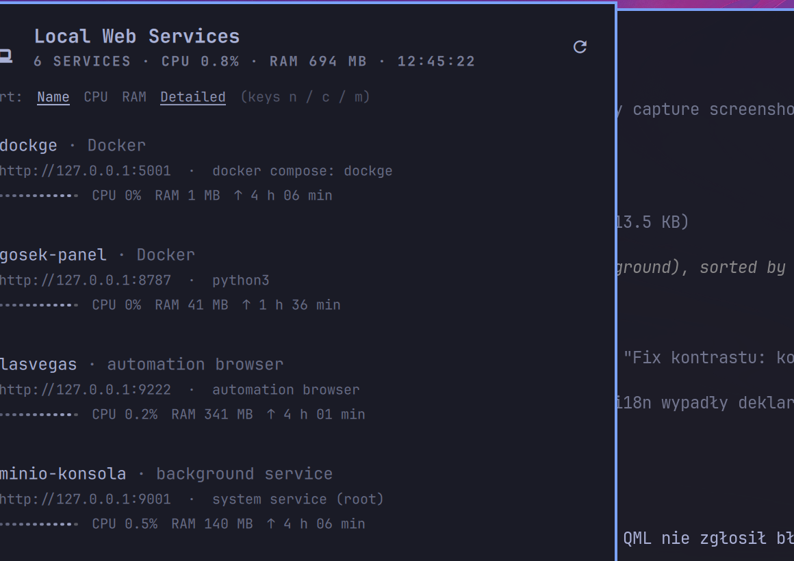

# Local Web Services — Omarchy bar widget

**pablo.uslugi** · Shows every local web service listening on your machine —
from Docker containers, user processes and system services — right in the
Omarchy bar. Click an entry to open it in your browser.



*(preview: compact rows, sorted by CPU; full view adds URL, technology detail
and a CPU sparkline)*

## Why

You run half a dozen small web UIs on your desktop — Docker containers, a
panel, a dev server — and remembering ports is a chore. This widget lists them
in plain language (**Docker**, **background service**, **venv**, **automation
browser**, …) with live RAM/CPU and uptime, and one click opens the right URL.

## Install

```bash
omarchy plugin add https://github.com/PNowakBG/omarchy-uslugi-www --enable
~/.config/omarchy/plugins/pablo.uslugi/install.sh   # expose the scanner in ~/.local/bin
```

Update: `omarchy plugin update pablo.uslugi` ·
Remove: `omarchy plugin remove pablo.uslugi` (then
`rm ~/.local/bin/uslugi-www-stan`).

## Usage

| action | how |
|---|---|
| open a service | click its row (opens `omarchy-launch-browser <url>`) |
| sort by name / CPU / RAM | buttons in the panel, or keys `n` / `c` / `m` |
| compact ↔ detailed view | link next to sort, or key `d` |
| refresh | key `r`, middle-click, or the ↻ button |
| show only one kind (permanent / tests / manual / tools) | the *Show:* row, or key `f` |
| rename a service | the pencil 󰏫 next to its name (Enter saves, Esc cancels, empty restores the automatic name) |
| colour a service | the dot ○ before its name, then a colour (or *no colour*) |

## Who exposed it, and is it permanent?

Every service carries a **kind** badge and three extra lines in the detailed view:

- **PERMANENT** — a systemd unit that starts on its own, a Docker container with
  restart policy `always`/`unless-stopped`, a root service from the map, or a
  process kept alive by pm2/supervisord,
- **AGENT TEST** / **TEST** — started by a coding agent, or from a git
  worktree; flagged in red when its folder no longer exists (orphaned leftovers),
- **MANUAL** — started by hand from a shell,
- **TOOL** — a coding agent's own port, or a server of the tool hosting it.

`by:` names the agent and its host (*Claude Code in herdr*), the systemd unit or
compose project, the project/worktree and the user. `exposed since … · last
start … · restarts: N` comes from the unit file / package install date / container
creation, the last (re)start, and restarts seen by the scanner
(`~/.local/state/uslugi-www/historia.json`, kept 30 days). `why:` lists the
evidence behind the badge.

Detection is generic — it does not assume a particular terminal or agent
manager. It was tested with herdr, tmux and a plain terminal; Rex, T3 Code,
Zellij, WezTerm, kitty and others go through the same rules (not tested here):

1. the whole parent chain up to the session boundary: the nearest known coding
   agent (Claude Code — also via the Agent SDK used by T3 Code and similar apps —
   Codex, Gemini CLI, OpenCode, Kimi Code, Cursor Agent, pi, omp, Grok, Copilot,
   Amp, Aider, …), a shell, and the first real program above them — shells and
   runners (`node`, `npm`, `uv`, …) are skipped, an unknown program in between
   (e.g. a dev-server reloader) does not hide an agent further up, and an
   unknown host is shown under its own name,
2. when the chain is broken (`nohup`, `setsid`, daemons): the oldest real process
   in the same systemd cgroup, which a process cannot leave; a detached process
   that carries a terminal environment (`TERM`) counts as **MANUAL**,
3. agent session markers in the environment: known names (`CLAUDECODE`,
   `KIMI_CODE_SESSION_ID`, `OPENCODE`, `GEMINI_CLI`, …), the convention
   `<AGENT>_SESSION_ID` / `_THREAD_ID` for any known agent, and `AI_AGENT`.
   Only variable **names** are used; the only values looked at are
   `TERM_PROGRAM` and `AI_AGENT` (a terminal / agent name, shortened) and whether
   a path contains `deploy/docker` — no other value is read into the output.
   Variables set for the whole session (`systemctl --user show-environment`)
   are ignored,
4. systemd: a service counts as the unit's own (PERMANENT when enabled) only if
   it is the unit's main process or its child with no agent and no terminal on
   the way; container units (the Hyprland session, a tmux/foot server, desktop
   apps) never make a service permanent,
5. the working directory: git repository, linked worktree (`*-wt/…`,
   `.claude/worktrees/…`, `~/.codex/worktrees/…`), or a deleted folder.

Teach it another agent in `~/.config/uslugi-www/agenci.conf`, one per line:

```text
# process-name  Display Name
myagent  My Agent
```

Names and colours set in the panel live in `~/.config/uslugi-www/uslugi.json`
(keyed by a stable id: container, systemd unit, or the root folder of the
project/worktree + program, plus port — so a name and colour survive restarts
and the deletion of the worktree folder or of a rebuilt subfolder such as `dist/`;
the scanner remembers each running process's project root while its folder exists).
From a terminal: `uslugi-www-stan nazwa KEY "Name"` / `uslugi-www-stan kolor KEY
zielony` (an empty value restores the default). Colours: `czerwony`,
`pomaranczowy`, `zolty`, `zielony`, `turkusowy`, `niebieski`, `fioletowy`,
`rozowy`, `szary`.

**Detailed view** shows URL, the exact technology (e.g. `docker compose:
dockge`, `systemd: gosek-panel.service (--user)`) and a 12-sample CPU
sparkline. **Compact view** fits every service on one line — no scrolling.
Sorting and the totals (`6 services · CPU 0.6% · RAM 695 MB`) are always
visible in the header.

## What it detects

The scanner (`bin/uslugi-www-stan`, python3 stdlib only) merges:

- **`docker ps`** — published container ports → **Docker** (with compose
  project name when present),
- **`ss -tlnp`** — listening sockets:
  - your own processes → **local process**, **Python venv**, **Node.js**,
    **Java**, **automation browser** (DevTools), …
  - **root/system sockets without a visible process** (MinIO, Sunshine…) are
    shown **only if you declare them in the map** (labelled *system service*),

plus cgroup-based detection of **Kubernetes**, **Podman**, **virtual
machines** (libvirt/QEMU), **LXC**, **Flatpak**, **Snap** and **AppImage**.
Well-known noise ports (DNS, CUPS, SSH, Sunshine, …) are always skipped.

## Friendly names & hiding: `~/.config/local-www.map`

```text
# port name            → friendly name (overrides the process name)
# port name !          → hide this port
# port name unit       → root service: systemd unit to read metrics from
# port name unit env   → override the environment label shown to humans
9000 minio-s3 minio.service
9001 minio-konsola minio.service
9222 lasvegas          # automation browser (DevTools, custom profile)
8787 gosek-panel Docker
```

Automation browsers (Chrome/Chromium with `--remote-debugging-port`) are named
after their `--user-data-dir` profile, so you never see a bare "chromium".

## Widget settings

| key | default | description |
|---|---|---|
| `refreshIntervalSec` | `15` | scan interval (min. 5) |
| `display` | `full` | `full` or `compact` |
| `language` | `auto` | `auto` (follows `LANG`), `pl` or `en` |

## Languages

Polish and English, chosen automatically from your system `LANG`; force one
with the `language` setting. Environment labels are translated in the QML
layer — the scanner emits neutral keys, and map overrides are always shown
verbatim.

## Requirements

Omarchy (or any Omarchy-shell setup) with `python3`, `ss` (iproute2) and
`omarchy-launch-browser`. `docker` is optional — only needed if you actually
run containers.

## Files

- `manifest.json` — plugin manifest (id `pablo.uslugi`, bar-widget),
- `Panel.qml` — bar widget + dropdown panel,
- `bin/uslugi-www-stan` — the scanner (python3, stdlib only),
- `install.sh` — idempotent symlink of the scanner into `~/.local/bin`,
- `local-www.map.example` — commented example of the port map,
- `tests/test_skaner.py` — scanner tests: `python3 -I -B -m unittest discover -s tests`.

## License

[MIT](LICENSE)
---

### Polski (skrót)

Widget paska Omarchy pokazujący **lokalne usługi WWW** (Docker, procesy,
usługi systemowe) z portami, RAM/CPU i uptime — klik otwiera usługę
w przeglądarce. Instalacja i skrót po polsku:

```bash
omarchy plugin add https://github.com/PNowakBG/omarchy-uslugi-www --enable
~/.config/omarchy/plugins/pablo.uslugi/install.sh
```

- sortowanie: Nazwa / CPU / RAM (klawisze `n` / `c` / `m`),
- widok zwięzły ↔ pełny (klawisz `d`),
- przyjazne nazwy i ukrywanie portów: `~/.config/local-www.map`
  (format: `port nazwa [unit] [środowisko]`, `!` ukrywa),
- odznaka rodzaju: **STAŁA** (systemd / Docker sam ją uruchamia), **TEST AGENTA**
  / **TEST** (uruchomił ją agent kodujący albo pochodzi z worktree; na czerwono,
  gdy jej folder już nie istnieje), **RĘCZNA**, **NARZĘDZIE**; filtr klawiszem `f`,
- linie „kto”, „wystawiona od · ostatni start · restartów” i „dlaczego”;
  rozpoznawanie jest ogólne (sprawdzone w herdr, tmux i zwykłym terminalu;
  Rex, T3 Code, Zellij i inne przechodzą przez te same reguły),
- ołówek 󰏫 zmienia nazwę wyświetlaną, kropka ○ nadaje kolor (pasek z lewej
  strony wiersza); zapis w `~/.config/uslugi-www/uslugi.json`,
- własni agenci: `~/.config/uslugi-www/agenci.conf` (`proces Nazwa`).
- język polski wchodzi automatycznie przy `LANG=pl_*`.
